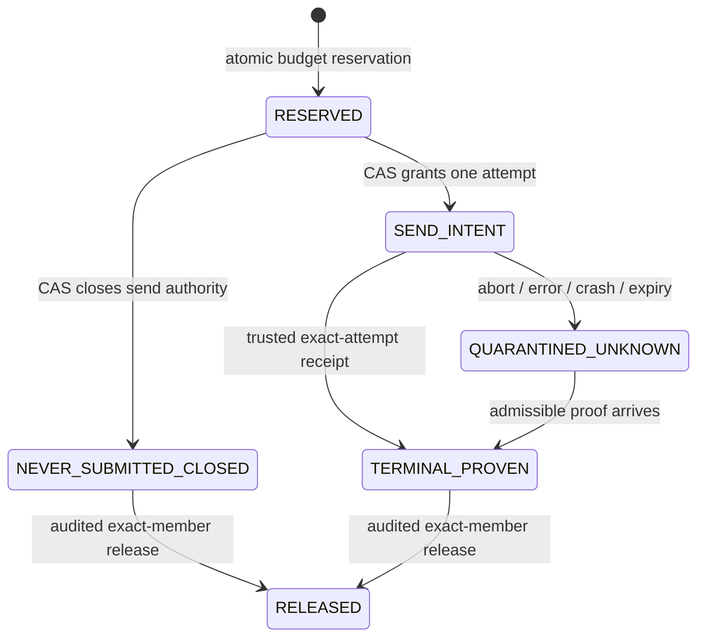

# Public Demo Chat — Redis Lease Recovery Design Research

調査日: **2026-10-29 (Asia/Tokyo)**。基準: **`main` / `cfb5319` / clean**。
開始時、プロセス環境の`DEMO_CHAT_ENABLED`は未設定、`.env.local`と`.env.example`は`false`。配備先の環境変数は閲覧していない。

初回調査は設計のみで、アプリ・テスト・依存関係・設定変更やテスト実行は行わなかった。その後、同じ基準HEAD上で**Operation ID / 予約相関の基盤だけ**を実装した（第2.5節）。初回調査・後続実装ともDB / Groq / Redis / Turnstileへの実サービス通信、実Redisキー操作、Production Build、Git add / commit / push / mergeは行っていない。以下の外部保証・復旧設計のNo-Go結論は維持する。

本文では **[確認]** をローカル実装・型定義または公開一次資料で確認した事実、**[推論]** をその事実から導く限界・反例、**[提案]** を未実装の設計、**[未確認]** を必要な保証・実環境証拠がない事項として扱う。過去PRの成功件数は今回の検証結果に転記しない。

## 1. Executive Summary

**結論: 現行同期Groq生成の、終了不明Leaseを一般的に安全かつ有限時間内に復旧する方式は成立確認できない。Public ActivationはNo-Go。**

- **[確認]** 現行実装は、上限2を期限切れLeaseも含む件数で管理し、不確実な生成を無期限に残す。正常な`stop` / `length`応答、またはSDK未呼出しが分かるローカル経路だけを解放する。2件残れば日付が変わっても能力は回復しない。
- **[未確認]** 同期Chat Completionsについて、Abort / HTTP切断後の生成停止確認、リクエスト単位の照会・キャンセルAPI、キュー時間を含む強制的な最大寿命は確認できない。SDKやFunctionの終了は代替証明にならない。
- **[提案]** 最初に、予約前に発行するoperation ID、Lease・invocation・Provider応答の相関、永続ライフサイクル記録、送信意図のCAS、証跡付き解放を設計・実装する。**証明可能な部分だけ**を復旧し、不明部分は保持する。
- **[推論]** 記録を増やしても、Redisへの送信意図記録とGroqへの送信を一つのトランザクションにはできない。送信意図あり・Provider応答なしは、実際には送信前でもquarantineが必要になる。
- **[提案]** 短期は①無期限quarantine＋②終了証跡限定解放＋③相関記録＋④監査付き手動復旧を組み合わせる。ただし、これは完全な可用性回復策ではなく公開準備の土台である。公開にはProvider側の終了証明・強制寿命、または生成方式の見直しが別途必要。
- **[未確認]** UpstashのLua原子性から、障害・leader交代・partitionを含む全体の線形化可能性までは導けない。対象構成の認められた予約が失われないことも公開前の確認事項とする。

## 2. Current Implementation

第2.1〜2.4節は初回設計調査時の`cfb5319`を記録する。後続の未コミット実装との差分は第2.5節を正とし、後半の提案済み機能を全て実装したとは扱わない。

### 2.1 基準コードと順序

**[確認]** 以下を直接調査した。説明の正はこのHEADのコードである。

| ファイル | 実際の役割 |
| --- | --- |
| `src/lib/demo/chat-handler.ts` | 設定・Origin・入力・cookie → Redis所有権 → public Research再検証 → client abort確認 → reserve → generation → JSON。reserve失敗時は生成へ進まない |
| `src/lib/demo/chat-config.ts` | 上限2、thread10 / session20 / shared source3毎60秒 / global50毎UTC日。C2では無効。memory fallback禁止 |
| `src/lib/demo/chat-model.ts` | Demo専用キー、固定Groq / `openai/gpt-oss-120b`。構築時に設定を再確認。モデル構築自体は通信しない |
| `src/lib/demo/chat-generation.ts` | SDK前の同期準備、30秒local timeout、15秒serial heartbeat、Abort伝播、終了判定、出力検証、finallyで条件付きrelease |
| `src/lib/demo/chat-store.ts` | Lua EVALによる予算＋予約、renew、exact-member ZREM。REST失敗は503、retryなし |
| `src/lib/demo/chat-security.ts` | 256-bitランダムID、60秒Lease期限、厳密Origin、Turnstile、cookie、入力制限 |
| `src/app/api/demo/chat/route.ts` | `runtime = "nodejs"`。route内に`maxDuration`設定なし |

**[確認]** `docs/architecture/ai-architecture.md`のPublic Demo generation / atomic limits / pre-release hardening、および`docs/planning/roadmap.md`のPR #45 / pre-release hardeningを確認した。復旧未実装・公開ブロックに矛盾は見つからない。古いPR番号の記述を現在の保証として扱わない。初回調査では両文書を変更せず、後続実装では予約相関基盤と未解決事項の区別を追記する。

### 2.2 Redisにある情報・ない情報

**[確認]** `${prefix}:concurrency`はSorted Setで、memberはランダムLease ID、scoreはRedis TIMEによるdeadline。キー自体にTTLを設定せず、予約時はexpired memberも含む`ZCARD`を使う。source bucketの期限掃除とConcurrencyの期限掃除は別物であり、後者は実装していない。

`RESERVE_QUESTION`は所有権・予算・容量を確認してカウンタを増やし、最後にLeaseを追加する。`RENEW_LEASE`はdeadlineが現在時刻以下なら失敗し、期限切れLeaseを復活させない。`RELEASE_LEASE`は指定memberの`ZREM`だけで、予算を減らさない。release成功値は数値`0` / `1`だけを許容する。

quarantineは明示的な状態フィールドではない。Timeout直後など、scoreがまだ未来でも「以後renew/releaseしない」Leaseがある。**expiredとquarantinedは同義ではない。** RedisにはWorker ID、submission状態、Provider ID、終了理由、release証跡、監査履歴がない。lease→thread/sessionの対応もConcurrency memberから復元できない。

予約IDは`reserve()`内部で発行し、成功応答後だけ返す。Redisで予約済みでも応答が失われると、呼び出し元はIDを得られない。Handlerは生成しないが、外からそのmemberの未送信を証明する材料も残らない。

### 2.3 生成と解放の正確な境界

**[確認]** built-in adapterでは、設定・モデル構築・Research JSON準備はSDK呼出しより前。失敗、既存client abort、証拠不足は`submitted=false`なのでreleaseする。opaque injected generatorは呼出し自体を送信境界とし、同期throwも不確実とする。

`submitted=true`は`submit()`直前の**プロセスメモリ内**フラグ。ネットワーク送信済みの証拠ではない。SDK内の入力処理・provider引数変換・JSON化・fetchなど、さらに複数段階がある。

正常にPromise.raceを通過し、`stopped=false`で`finishReason`が`stop` / `length`なら`completed=true`となる。`length`は回答として503だがLeaseは解放する。`stop`後の回答JSON不正も解放する。provider rejection / 未知reason / Timeout / client abort / renew失敗はquarantine。キャンセル競合後の遅い正常応答も現行では解放に使わない。

releaseの応答喪失時は、Redisでは既に消えていても回答は503になる。現在は再試行しない。0件削除はidempotent結果として許容されるが、**0だけでは誰がなぜ消したかの証跡ではない**。同じLease IDを使い回さないことと、解放呼出し側の終了判定が安全性の前提。

### 2.4 テストから確認できる範囲

**[確認・静的確認のみ]** `chat-generation.test.ts`、`chat-generation-sdk.test.ts`、`chat-store.test.ts`、`chat-redis.test.ts`、`chat-model.test.ts`、`chat-config.test.ts`、`chat-security.test.ts`を確認した。

既存ケースには、実LuaのFengari実行、独立storeから上限2、期限切れquarantine、2件枯渇、予算非返金、opaque throw、SDK前準備失敗、Abort rejection、遅いcompletion無視、reserve / renew / releaseのcommit後応答喪失がある。SDKテストはfetchをinterceptし、Redis adapterはRedisコマンドを模擬する。Provider停止保証、Upstashの実durability / partition、Vercel強制終了の証明ではない。本調査では再実行していない。

### 2.5 後続実装: Operation ID / 予約相関の基盤

**[実装済み・未コミット]** これは第11節PR Aの最小段階。送信権CAS、Provider相関、終了証跡、照会/復旧API、自動解放は未実装。実装前の確認では、これらを実装しない範囲で現行コードと重大な矛盾はなかった。同一IDへの成功結果の再交付は二重生成を招くため、この段階では**再照合による生成再開をせず重複を拒否**する。

- handlerは既存の設定/Origin/入力/cookie/所有権/public Research再検証後、Redis予約呼出し前に`randomBytes(32).toString("base64url")`でOperation IDを作る。Lease IDはstoreで別に発行し、どちらもEVAL前に確定する。クライアントの任意IDはstrict JSONで拒否し、レスポンスやログにIDを追加しない。
- `${prefix}:operations`というRedis HASHのfieldをOperation ID、valueをJSON `{schema:1, leaseId, scopeHash, reservedAt, reservationState}`とする。scopeHashは`SHA-256(JSON.stringify([SHA-256(session), thread, research]))`。問・答・生cookie・token・公開データ本文は保存しない。RedisにアクセスできればOperation IDから対応Leaseを追跡でき、逆方向はこの上限付きHASHの記録から調べる形で、管理ツールは実装しない。
- 既存reserve EVALの所有権/容量/予算確認後、予算を変更する**前**に`attempted`を書き、全予算とLease追加後に`reserved`へ更新する。どちらの状態にも開始時のRedis TIME（`reservedAt`）を記録する。通常の拒否では新record/質問予算消費なし。ただし既存source bucketの期限掃除は従来どおり起こり得る。
- Lua途中errorにはrollbackを仮定しない。`attempted`と部分消費/Leaseが残り得るが、同じOperation IDが既に記録されていれば再予約を拒否する。partial stateを修復・返金・解放しない。
- 初回成功ackだけがLeaseを返す。同じIDは並行Workerでも、正常解放後でも`duplicate`として内部503で拒否し、旧Leaseを再交付しない。既知のLua拒否は`rejected`、通信/Lua errorや不正応答は`unknown`という内部error outcomeに区別し、Operation IDを保持する。公開errorは従来のgeneric bodyのまま。
- 予約commit後の応答喪失でも、Redisが書込みを保持していればOperation→Lease記録が残る。handlerは自動retryもAI呼出しもしない。record不在は未実行の証明ではなく、遅れてEVALが届くことやstorage障害を排除できない。
- **`reservationState`はProvider lifecycleではない。** `reserved`は通常終了・Abort・Timeout・quarantine・Lease解放後も変えない。第8節の将来状態機械のfenced `RESERVED`とは異なり、未送信・終了・稼働を証明せず、状態を理由に解放してはいけない。
- replay防止はRedisに記録が残る**同一サーバーOperation ID**を共有した呼出しが対象。独立したHTTP再送は新しいIDの別質問となり既存予算で制限する。入力文の同一性から重複判定しない。HTTPをまたぐexactly-onceには、認証されたserver-issued request token等の別protocolが必要で、この基盤では保証しない。
- recordにはTTL/GC/解放時削除を設けず、**10,000件**で新規予約を503 fail-closedにする。renew/安全な既存releaseは継続できる。50問/日なら空から概ね200日だが、部分失敗でrecordだけ増えれば早まる。field+valueは1件300 bytes未満、上限時3MB未満のpayloadで、Redis allocator/index/replication overheadを含まない。容量回復のために既存recordを消す運用は承認していない。
- 相関HASHはUpstashの障害・複製・evictionを超えて必ず残る「永続証跡」ではない。対象構成のdurability/ack保持/順序付けは引き続き未確認。全外部保証、旧Lease、2枠quarantine、公開No-Goは未解決のまま。

関連オフラインテストは、乱数IDの形状/標本一意性、同一EVALの対応関係、同一ID競合、解放後再試行、拒否副作用、commit前/後応答喪失、遅延EVAL、Lua途中error、record上限、型不正、既存生成/予算/セッション/認可を対象とする。標本一意性やmock成功はCSPRNG衝突不能、Upstashの障害下保証、Groqの終了を証明するものではない。

**後続実装の検証結果**: `pnpm exec vitest run src/lib/demo src/app/demo/pages.test.ts scripts/demo-chat-redis-safety.test.ts`は11 files / 261 tests成功。`pnpm exec tsc --noEmit --incremental false`、全体`pnpm exec eslint`、`git diff --check`も成功。Vitestはsandboxの子プロセス起動制限（`spawn EPERM`）後、許可されたsandbox外実行でオフライン検査を完了した。全Vitest・Production Build・実サービス検証は実行していない。

## 3. Failure Scenarios

各「提案後」は第8節の未実装状態機械、および第7節のストレージ前提が成立する場合に限る。

| 障害 | 現行の結果・安全な扱い | 提案後の成立条件 / 反例 |
| --- | --- | --- |
| Groq送信前にFunction終了 | finallyが動かなければLease残留。Redisから未送信とは分からない | `RESERVED`のままなら送信CASとの競合で閉鎖できる。`SEND_INTENT`へ進んだ後は、実送信前の死亡でも不明として保持 |
| Groq送信後にFunction終了 | SDK待機・ローカルフラグ・終了応答を失い、無期限保持 | exact attemptの永続terminal証跡が既にあれば解放候補。Function終了記録だけなら不可 |
| 生成中にclient切断 | signal通知があればlocal abort＋quarantine。配備先での通知・cleanup実行は未検証 | `after`等は証跡保存成功率を上げるだけ。通知なし・即時終了でも枠を残す |
| Timeout後も上流継続 | 30秒でlocal待機を停止し保持。60秒で削除しない | 上流が10分以上待機/生成する反例を排除できないため時間解放不可 |
| renew応答喪失 | 更新済みでもWorkerはstop。Lease保持 | version付き更新・readbackは診断用。renew成功はProvider終了証明にも、新たな送信許可にもならない |
| release実行後に応答喪失 | Redisで削除済みなら枠は空くが回答503。未実行なら残る | 同一operation IDと同一proofでのみ再照会/再適用。再生成・再予約・予算返金をしない |
| reserve成功後に応答喪失 | 生成しないが、WorkerにはLease IDが返らず孤立 | reserve前発行IDで同一結果を照合。未確認のまま送信禁止。新IDで自動再試行しない |
| Redisが一時利用不能 | 新規admission拒否、renew失敗でlocal abort。既存上流の停止は不明 | 復旧時は同じledgerを照合し、不明なら保持。新しい空namespaceへ切り替えない |
| 2件quarantine | 429で全生成枯渇。UTC日替わりでも回復しない | incident通知→admission停止→証跡分類。証跡なしなら両方保持。枠の一時増加は禁止 |
| 古いWorkerが遅れて再開 | 管理者が期限だけで消すと、保持していたIDで送信して置換Workerと重なる | `RESERVED`閉鎖後は送信CAS拒否。送信許可取得後のWorkerはGroqがfenceを検証しないのでquarantineを解放しない |
| 同一Leaseの復旧を重複実行 | ZREMはidempotentだが、証跡/操作履歴はない | expected version、owner、attempt、proof、復旧IDを同一Luaで比較。既処理なら同じ結果、別proof/対象混同なら拒否 |
| terminal受信後、保存前にWorker死亡 | 現行finally前なら枠残留。正常だったことが失われる | 受信と永続保存も別処理なので完全には閉じられない。証跡保存なしを終了済みにしない |
| Redisのack済み予約がfailoverで見えなくなる | エラーが返らず空枠に見える場合、アプリのfail-closedだけでは検知できない | 2生成中にledgerが失われ、さらに2件通す反例。対象構成の保証解決まで厳密上限の証明を保留 |

## 4. External Specification Findings

### 4.1 Groq API

**[確認]** 現行の対象は`POST /openai/v1/chat/completions`の非stream応答。公式型定義で`finish_reason=stop`は自然停止/stop sequence、`length`は指定token上限到達を表す。completionの`id`とGroq固有`x_groq.id`は区別される。これは当該応答の終了情報であり、Abortへの応答でもシステム全体の無稼働証明でもない。[G1][G2]

**[確認]** 公式TypeScript SDKのrequest optionsには`signal: AbortSignal`、streamには`controller.abort()`がある。これはクライアントリクエスト/読取の中断方法。**[未確認]** 中断完了がサーバー計算停止・未課金・即時停止を保証する記述は見つからなかった。公式SDKのtimeout既定1分はクライアント待機設定であり、このアプリはそのSDKを使用していない。[G3][G4][G5]

**[未確認]** 調べたAPI Referenceと公式SDKのChat Completions resourceには、同期リクエストIDを指定する状態照会・取得・キャンセル操作が確認できない。公開資料に見つからないという結論であり、非公開契約や将来APIの不存在を断言しない。HTTP切断後の継続時間、queueを含むwall-clock最大寿命も未確認。700 token制限、通常のtokens/secや平均latencyを時間上限へ換算しない。[G1][G2][G6]

**[確認]** Groq Consoleにはリクエストログ/latency等の観測機能がある。**[未確認]** それを機械的に照会できる同期job状態API、終了不明requestを漏れなく列挙できる保証、ログ不在が未受付を意味する保証。ダッシュボードの件数0や使用量の横ばいは終了証拠にしない。[G6]

**[確認]** Batchは実在する別API。作成、取得、一覧、cancelがあり、cancel直後の`cancelling`と完了した`cancelled`を区別する。ドキュメントはcancel処理に最大10分、処理windowに24時間〜7日を記載する。既存同期requestを後からBatchへ変換するAPIではない。Billing FAQはBatchをDeveloper tierの特典として挙げるため、無料で利用可能とは扱わない。[G1][G7][G8]

**[確認]** Responses API(beta)の応答に`background` / `status`等があっても、調査した公開Referenceではcreateが中心で、`store`は非対応。**[未確認]** このアプリの要件を満たすbackground create→retrieve→confirmed cancelの一式。OpenAI互換という名称からOpenAI側のAPIをGroqにも仮定しない。[G1][G9]

### 4.2 Vercel Functions

**[確認]** Fluid Compute有効時の公開上限はHobbyがdefault/max 300秒、Pro/Enterpriseがdefault 300秒、通常max 800秒、条件付きBetaで1800秒。maxDuration超過はFunction終了・504。**[未確認]** 当該配備のplan、Fluid設定、実効maxDuration。ローカルrouteに指定がないことから配備値を確定しない。[V1]

**[確認]** cancellationはNode.jsでpath単位opt-in。通知時は`request.signal`がabortし、contextは回収され得る。`waitUntil` / `after`に入れない後処理は失われ得る。`waitUntil`もFunctionと同じtimeoutを共有する。SIGTERMのcleanup猶予は通常Functionで最大500ms。いずれもRedisへの記録やfinally完遂を保証するdurable executorではない。[V2][V3]

**[確認]** Next.js 16.3.8のローカルNode adapterも、responseの`close`が`writableFinished`より先ならsignalをabortする。Vercelのプロキシ・cancellation設定を含む実client切断の到達条件はローカル実装だけでは証明できない。

**[推論]** Function終了でローカルHTTP接続が失われても、既に受信した外部サーバーでの処理終了を意味しない。調査したVercel資料はGroqの生成停止を保証していない。送信失敗/AbortSignalはlocal communicationの情報としてのみ扱う。

**[確認]** Vercelは多数の同時invocationへ自動拡張する。実行インスタンスを一つと仮定せず、アプリの上限2は共有ledgerで守る。Fluidでは同一インスタンスを複数invocationが共有し得るため、プロセスIDは処理IDの代用にならない。[V1][V4]

**[確認]** runtime logsにはruntime用Request Id等がある。公開retentionはHobby1時間、Pro1日、Enterprise3日、Observability Plusでは30日。**[未確認]** crash直前のログの完全配送・全件性。ログがないことを未送信証拠にしない。終了後に必要な証跡は終了前にdurable storeへackを得て保存する必要があるが、その保存前の死亡リスクは残る。[V5]

### 4.3 AI SDK 6 / Groq Provider（インストール済みを優先）

**[確認]** `ai@6.0.280`、`@ai-sdk/groq@3.0.72`、実際に解決される`@ai-sdk/provider-utils@4.0.57`を確認。`generateText`はsignalをmergeし、`doGenerate`→`postJsonToApi`→fetchの`signal`へ渡す。Providerは非streamのJSON全体を読取・schema処理してからresultを返す。HTTP error、読取/parse error、Abortでrejectし得る。[L2]

`maxRetries: 0`をアプリが明示するため、AI SDKの通常retry既定値2は適用されない。モデル呼出し前の内部検証失敗もあり得るが、現行はSDK呼出し後のthrowを未送信証明にしない。アプリのsubmission境界は実fetchより保守的。

**[確認]** Groq providerは`stop` / `length`を対応するunified reasonへ変換し、未知値は`other`。finishReasonは受信済み応答の終了理由であり、ローカルPromise rejectの理由とは別。回答の根拠・正しさ・全attemptの終了は保証しない。

**[確認]** SDK結果はresponse ID、timestamp、modelId、headers、body、rawFinishReason等を持つ。Provider IDがない場合はAI SDKがIDを生成するので、**SDKの`response.id`が非空というだけでProvider IDとは判定できない**。Groqのraw bodyに`x_groq.id`があればwhitelist検証して別フィールドへ記録できるが、現行wrapperは`text`と`finishReason`しか返さず全て破棄する。エラーのheaders/statusにも手掛かりがあり得るが、到達・終了証明とは限らない。

**[確認]** オンラインAI SDK docsと`v6.ai-sdk.dev`の確認先はv7へredirectした。現行v6のAPI判断には同梱source/docs/typesを使い、v7の機能やGroq公式SDKの機能をインストール済みproviderに移植して解釈しない。[A1][A2]

### 4.4 Upstash Redis

**[確認]** EVALはread→判定→writeを原子的に行う用途を公式に説明し、通常pipelineは原子的ではない。現行のようなLuaは通常global lockで実行される。ただし、原子性、通信の成功確認、durability、複製整合性は別の性質。[U1][U2][U3]

**[推論]** RESTタイムアウトは「未実行」と「commit済み応答喪失」を区別できない。現行テストにも後者の合成ケースがある。結果不明なら同一operationの照合を優先し、別IDでのmutating retryをしない。**[確認]** インストール済み1.39.0では`retry:false`は最大2回fetchする実装で、現行は`retry:{retries:0}`と3秒signal関数により1回に制限している。現行コードを単に`false`へ書き換えてはならない。[L3][U4]

**[確認]** Durable Storageはwriteをmemoryとdiskへ保存するとの説明。一方Consistency資料は非同期複製・eventual consistency・partition後LWW収束を説明し、以前のstrong consistency modeはdeprecated。Global DatabaseはwriteをPrimaryへ送り、readは近傍Read Regionへ送る。**[未確認]** 対象DB構成におけるwrite EVALのfailover時線形化とack済み予約非喪失。read-your-writes tokenや同一regionだけでこの穴を埋めたと主張しない。[U5][U6][U7]

**[仕様との要確認事項]** 既存architectureは全Workerが同じdurable namespaceを使う前提で上限を説明している。Luaの通常動作はそれと整合するが、partition/failoverまで含む厳密な上限保証には公開資料だけでは不足する。これは実際にoversubscriptionしたという発見ではない。対象plan/構成に適用される保証をvendorに確認し、必要なら要件を満たす権威ストア/実行基盤を別設計する。既存仕様を黙って緩和しない。

**[確認]** evictionは既定offだが、onなら非TTLキーもdurable storageから消え得る。無期限Lease/未解決証跡をTTL・eviction・namespace resetで消さないことが前提。[U8]

### 4.5 Free Tierの現実的な運用

**[確認]** 現行Upstash料金表はFree: 250MB / 月500K commands / 月10GB bandwidth。FAQには旧来と見られる10,000/dayの記述も残るため、現行料金表を優先し、対象契約のquotaを将来の許可された確認で確定する。Free DBは30日以上の非使用でarchiveされ得る。復旧時に空DBを新規作成して再開する設計にはしない。[U9][U10]

**[提案・概算]** 50問/日×31日=最大1,550件/月のaccepted questions。仮に1件10回のtop-level Redis操作なら15,500回/月、1分ごとの確認1回だけでも44,640回/月になる。これは予算感を見るためのHTTP操作概算であり、実課金command数の保証ではない。Lua内部commandのquota算入、session start、拒否request、再照合、監査保存、bandwidthを別途計上する。特に50問上限は拒否requestが消費するRedis操作を上限化しない。

**[提案]** 常駐poller・毎秒scanを置かず、既存request/incident時の有限な照合と、許可された管理操作時のdry-runを中心にする。詳細監視機能を無料で使えると仮定しない。未解決記録は容量都合でも消さず、容量超過時はadmissionを閉じる。token/プロンプト/回答を保存せず、IDと証拠の必要最小情報に限定する。

**[確認]** Vercel Hobby cronは1日1回、時刻は指定時間内で最大59分ずれる。秒〜分単位の復旧SLOをHobby cronへ依存できない。BatchはDeveloper tier前提として評価し、無料構成の解とは扱わない。[V6][G8]

## 5. Verified Guarantees vs Unknowns

| 論点 | 確認できたこと | 未確認 / 証明に使えないこと |
| --- | --- | --- |
| local timeout | 30秒timerがabort/拒否を要求する実装 | event loop停止中の正確な発火、remote終了時刻 |
| Lease deadline | Redis TIME、60秒、期限切れrenew拒否 | Worker/Provider停止、空き枠の発生 |
| HTTP Abort | signalがProvider fetchへ渡る | Groqが生成停止したとのack |
| Function終了 | maxDuration、cancellation、SIGTERMの公開動作 | Groq終了、finally/ログ/Redis write完遂 |
| stop / length | 対象の正常応答が生成終了理由を報告する | 別attemptの終了、ID未記録時の事後対応付け |
| Provider ID | 応答にcompletion IDとGroq request IDの形式がある | 応答前の必須ID、紛失requestの一覧取得、IDだけで状態照会 |
| Lua | 同一EVAL内の判定と更新の原子性 | 他サービスとのtransaction、REST exactly-once、障害下の全体線形化 |
| persistence | Upstashはdisk保存を説明 | 対象構成の全failoverでack済み予約を失わない保証 |
| logs | 取得可能なruntime / Provider観測がある | ログの全件性、ログ不在から未送信/終了と判定すること |
| Batch | retrieve/list/cancel APIと状態が実在 | 同期生成の救済、作成応答喪失の完全な解決、内部同時実行上限2 |

**[推論: 不可能性の核]** Redisに「送信意図あり・終了証跡なし」が残る二つの履歴を考える。

1. Workerが意図を書いた直後に死亡し、Groqへ送信していない。
2. Groqが受理して生成中だが、Worker死亡により応答も記録も失われた。

復旧者には同じ記録が見える。有限時間で必ず解放する規則は2でも解放してしまい、既存2件が継続中なら置換で3件以上になる。常に保持する規則は1でも能力を回復できない。Provider終了照会/強制寿命等の追加情報がなければ、厳密安全性と有限時間の可用性回復を同時には保証できない。

## 6. Recovery Design Options

「無料適合」は運用費の傾向であり、対象アカウント/実稼働の認証ではない。いずれもRedis障害時fail-closedを維持する。

| 案 | 安全性・成立条件と反例 | 実装 / 運用の複雑さ | 障害時の復旧可能性 | Vercel・Upstash / 無料枠 / 残存不確実性 |
| --- | --- | --- | --- | --- |
| 1. 無期限quarantine | 不明Leaseを再利用しない。ledgerが失われず全生成がこのgateを通る条件。保存state喪失は別問題 | 低 / incident対応は高 | 未終了証明なしでは0。2件で恒久停止 | 無料でも可能だが可用性なし。Function寿命に依存しない |
| 2. 確実な終了証跡のみ解放 | exact attemptの非stream stop/length等と「再送なし」を証明。HTTP200やPromise resolveだけは不可 | 中 / 中 | 証跡保存済み・release応答喪失は回復可能。保存前死亡は不可 | 少量receipt保存は無料枠候補。Function終了前の保存機会を失う |
| 3. Lease・Worker・Provider相関 | operation/attempt/invocation、provider由来IDを分離。相関は停止証明ではない | 中 / 中 | 孤立予約・照合を改善。send-intent不明は残る | Redisへ少数write追加。ログretention依存を減らす。provider ID未受信はnullのまま |
| 4. 監査付き手動復旧 | admissible proof＋送信権閉鎖＋exact-member CAS。承認者2名でも証明欠如は補えない | 中〜高 / 高 | 証拠があるLeaseのみ。legacy不明Leaseは回復不可の場合あり | 管理専用認可・dry-run・audit・重複制御が必要。安全な無料self-service resetではない |
| 5. 時間ベース | remote hard boundと最終受付可能時刻の上限が契約/実装で強制される場合のみ。60秒/Function最大時間/700tokenだけは不可 | 条件を得られれば中 / 中 | 条件未確認の現行では不可 | timer/cronは実行機会を作るだけ。Hobby分単位cron不可。想定より遅い受付/生成が反例 |
| 6. Groq状態照会・cancel確認 | 同期用は未確認。Batchなら実在APIでterminalを照合し得るがcancellingでは不可 | 高 / 高 | 新Batch設計の対象jobのみ条件付き。同期Leaseには適用不可 | Developer tier、長いlatency、file保持、作成応答喪失の照合、1batch内並列が課題 |
| 7a. durable worker / queue / workflow | 観測を増やせるが外部生成をexactly-onceにはしない。送信済み不明stepを自動再実行すると危険 | 高 / 中〜高 | receipt失敗を減らすがProvider不明は残る | Vercelのrequest寿命と切離す追加基盤。無料枠・delivery/replay保証は未調査、即採用しない |
| 7b. 上限1・短い出力・stream化 | 同時上限1でも不明1件の再利用は危険。stream切断も終了証明でない | 低〜中 / 中 | 枯渇確率を変えるだけ。一般解ではない | token費を減らしても安全な復旧根拠にはならない |
| 7c. ライブ生成を停止し事前生成/固定デモ | runtime Groq生成が0なら公開閲覧時のremote concurrency問題を避ける。既存不明Leaseは消さない | 中 / 低 | ライブ生成の復旧不要。生成準備は別の管理対象 | 無料向きだが製品仕様変更。生成済みだと明示し、今回の実装や認可緩和は行わない |
| 7d. Provider側で上限/終了を強制できる基盤へ変更 | account/project単位のhard concurrency＋終了証明を契約確認できれば候補。API rate limitはconcurrencyと違う | 高 / 中〜高 | 条件が揃えば一般的復旧に近づく | Provider/料金/品質/認可・データ境界を再審査。現在利用可能との確認はしていない |

### 時間ベース方式が成立するための式

**[提案・条件付き]** `T_last_accept`を、そのattemptがProviderに最後に受理され得る時刻の証明済み上限、`B_remote`を受付からqueue・prefill・生成・取消処理まで含む強制最大時間、`Δ`を時刻/証明の不確実性の上限とすると、解放時刻は少なくとも`T_last_accept + B_remote + Δ`以降である必要がある。さらに、同attemptの新規送信権を恒久に閉じる。

**[未確認]** 現行には`T_last_accept`も`B_remote`もない。Workerの「送信直前」時刻は最終受付時刻ではなく、途中のqueue/network遅延や遅れて再開したWorkerで後ろへずれる。fenceを読んだ直後に停止し、復旧後に送信するcheck-to-sendの競合もある。固定の数分待機や安全係数は上限証明にならない。Providerが認識し強制する絶対deadline/受付期限、または同等の契約が得られるまで本案は不採用。

## 7. Safety Invariants

以下は**[提案: 実装と保証の両方で満たす必要がある不変条件]**。現行で全て満たしたという宣言ではない。

1. **対象範囲を固定する。** Public Demo専用全deployment/region/workerからの未終了生成と受付済み未終了requestを同じ容量で数える。Previewを隔離する場合も、同じ公開上限へ干渉する旧Worker・同じcredentials経路を見落とさない。SaaS Gemini/C2はこの復旧操作の対象外。
2. **`actual outstanding ≤ occupied leases ≤ 2`。** 送信を許可したattemptは必ず一意のoccupied Leaseに対応し、不明ならoccupiedのまま。枠を減らすには「当該attemptの今後の送信なし」かつ「未送信/終了の証明」が必要。
3. **ストレージ前提を明示する。** admission・送信CAS・証拠保存・releaseが一つの権威状態で順序付けられ、ack済みのoccupied/intent/tombstoneが失われず巻戻らない。未解決記録にTTL/evictionなし。障害時の不明な状態を空に初期化しない。この前提はUpstash対象構成について未確認。
4. **未送信閉鎖はCASで送信許可と排他的。** 管理者が観測した古い`RESERVED`を無条件削除してはならない。送信許可取得済みを未送信へ戻さない。
5. **一つの許可で一度だけ送信する。** application/SDK/queueの自動再送・fallback・tool loop・replayをしない。新しいWorkerが同じsend-intentを引き継いで再生成しない。redirect/proxyの送信挙動も公開前に確認する。
6. **Redis fencingをProvider fencingと混同しない。** fencing tokenは古いRedis更新を拒否するだけ。Groqがtokenを検証しない限り、送信許可取得済みWorkerや上流生成を止めない。
7. **証拠と回答を分離する。** terminal proofは信頼したadapterが正常受信した応答から作る。利用者/LLMの文章、client申告finishReason、status200だけを証拠にしない。出力検証失敗でも終了証明は保存できる。
8. **原子的・限定的な解放。** Lease/owner/attempt/version/proof/operation IDを照合し、そのmemberのみ解放。ZREM0だけを成功証拠にせず、対応する完了記録を照合する。不一致は保持・incident。
9. **予算は返金しない。** reserve応答喪失、未送信閉鎖、provider失敗、手動復旧のどれでもthread/session/source/globalのaccepted counterを減らさない。
10. **fail-closedを維持する。** Redis error/不明state/証拠欠如は新送信禁止。memory fallbackなし。公開APIへ管理操作を追加せず、Origin/Turnstile/cookie/所有権/public Research再検証を保持する。

**[推論: 条件付き安全性の説明]** 初期occupied=0、reserveが原子的に2未満だけ増加、送信にはoccupiedを持つ一回許可が必要、解放はそのattemptが今後実行されない場合だけ、と帰納すると上記2を維持できる。ledgerの巻戻り、許可の再使用、証拠なし解放が一つでもあればこの証明は崩れる。有限個のテスト成功だけでストレージ/Providerの未確認保証を補うことはできない。

## 8. Recommended Design

### 8.1 推奨の範囲

**[提案]** 不明Leaseを解放する一般的自動reaperは作らない。相関と証拠を先に整備し、次の二種類だけを復旧対象にする。

- **未送信を閉鎖できるもの**: 一度もsend-intentを許可していない状態をCASで不可逆に閉じる。
- **終了を証明できるもの**: exact attemptのtrusted terminal receipt、または適用範囲を確認したProviderの停止完了証明が永続保存され、再送権がないもの。

現行schemaで状態不明の既存memberは`LEGACY_UNKNOWN`として保持する。新schemaを導入しただけで古いmemberを未送信扱いにしない。新namespaceへ移して旧2枠を忘れることも禁止。

### 8.2 データモデル案

**[提案]** 既存の予算管理を残し、schema versionを持つ内部ledgerを追加する。名称は設計上の例で、今はRedisを操作しない。

| 記録 | 必要な内容・制約 |
| --- | --- |
| operation | reserve前にserver発行するランダムoperation ID、requestごとのinvocation ID、deployment/build identity、lease ID。body/問/答/secretを含めない |
| Lease lifecycle | immutable owner/attempt、state、monotonic version、Redis時刻、deadline、send-intentの有無、terminal proof reference。unknownをdefaultにしない |
| Provider correlation | provider、model、completion ID、Groq request ID、IDの由来/存在有無。未受信はnull。SDK生成IDをprovider IDと偽らない |
| proof | kind、exact attempt、trusted producer identity、received時刻、stop/length等の許可理由、最小限の検証済みmetadata。raw response本文・全headersは保存しない |
| recovery operation | 一意な復旧ID、actor、reviewer、incident、target/version/proof、理由、dry-run digest、適用結果、Redis時刻。変更不可の監査exportを将来設計 |
| control | schema/provisioning identity、admission closed状態、deployment epoch。epoch変更だけで旧上流が停止したとは扱わない |

invocation IDはprocess/instanceとは別に毎回発行する。terminal後のtombstoneはoperation replayを拒否できる期間保持し、未解決Lease/intentは無期限保持。GCは「全実行元の再試行不能・送信権消滅」が確認できた完了記録だけを対象に別審査する。単純なTTL消去で再実行可能にしない。

### 8.3 状態機械と実行規則

図の`SEND_INTENT`は「Providerが受理済み」を意味しない。deadline経過でcapacityを減らす矢印はない。

1. **予約**: operation/Lease IDを事前に発行し、予算増加・occupied追加・`RESERVED`記録を同じLuaで行う。同一operationの再照合は同じ結果を返し、予算を二度増加させない。応答不明のWorkerは送信しない。新しいIDで自動reserveし直さない。
2. **送信許可**: 最終のローカル準備後、owner/attempt/version/controlを照合して`RESERVED→SEND_INTENT`をCASする。成功ackを受けたそのinvocationだけがSDKを一度呼べる。許可応答喪失時は送らず、その状態をquarantineとする。成功応答を失った許可をlookupで再発行・再利用しない。
3. **未送信復旧**: 管理者/将来のreconcilerが`RESERVED→NEVER_SUBMITTED_CLOSED`を同じ権威ストアでCASする。送信CASが先なら閉鎖失敗・保持。閉鎖が先なら古いWorkerのCASが失敗し送信できない。deadlineは調査のきっかけにだけ使う。
4. **生成**: 既存のtimeout/abort/heartbeatを保持し、renewを送信権やremote稼働証明にしない。取得済みintentを別Workerへ移さず、エラー後再生成しない。late responseの証跡採取を将来追加しても、回答を復活させず、receipt保存と解放の規則を通常終了と共通化する。
5. **終了証跡**: 正常な非stream stop/lengthのexact attempt receiptを永続保存し、その後だけrelease候補にする。IDがない場合もnullを明示し、観測したinvocation/attemptを誤結合しない。receipt保存応答不明は照合対象、保存確認不能なら保持。
6. **release**: proofとexpected state/version、owner、復旧IDを検証して、audit・terminal tombstone・exact-member削除をLuaで扱う。同じ復旧ID/同じ入力なら同じ論理結果を返し、別入力での再利用は拒否。通信不明なら再生成せず同じoperationを照合する。

**[設計上の注意]** Lua原子性をrollback保証とみなさない。型/schema/argument/状態の検証を更新前に行い、capacityを減らす操作を安全な最後の段階へ置く。途中のwrite/OOM/runtime errorは部分状態が残る可能性を前提に、slotを温存して診断できる表現を選ぶ。metadataがterminalでもmember残留を許容して照合できるようにし、途中エラーを成功と扱わない。具体的なwrite順序と部分失敗モデルは実装PRで証明・テストする。

**[限界]** この設計でもSEND_INTENTの不明枠は回復しない。Provider受信とRedis receiptのatomic commitは作れない。全履歴でexactly-once生成を達成したという主張ではない。

### 8.4 監査付き手動復旧の成立条件

**[提案]** 任意のZREMを許すresetツールは作らない。管理者は以下をすべて満たすLeaseだけを解放できる。

1. 環境・namespace・schema・Lease・attempt・versionを一意に指定し、dry-runで証跡と現在状態を提示する。legacy/矛盾stateは通常操作で解放不可。
2. 対象Workerの**将来の送信権が閉じている**ことを確認する。未送信CAS閉鎖、または一回送信済みで再送不能な状態と対応する終了証明を要求する。cached環境変数、フラグoff、新deploy、heartbeat欠如、Redis epoch変更だけでは成立しない。
3. exact attemptのadmissible proofを確認する。正常terminal receipt、またはProviderが対象requestの終了完了と再開なしを確認した認証済み・監査可能な証明。support回答を使う場合も、request同定/網羅性/今後の処理なしの範囲が必要で、単なる「通常止まる」は不可。
4. actorとreviewerを分離し、incidentと証拠を記録する。二者承認は誤操作対策であって上流終了の証明にはならない。管理経路は公開Demoから隔離し、認証・最小権限を設計する。
5. CASで上記条件を再評価してexact-memberだけを解放する。承認後にstateが変われば拒否し再review。重複操作・応答喪失は同じoperationの照合で処理する。
6. 予算counterを一切減らさず、結果と監査保存の確認後にのみ運用上の復旧完了とする。証跡が不足する場合は停止を継続する。

**[既存Leaseの扱い]** 現行memberだけでは未送信を証明できない。全senderの停止を確実に確認しても、受理済み/通信中のGroq requestの終了確認は別に必要。キー失効は新規受付抑止であり既存生成停止とは仮定しない。この二条件の証拠を得られなければ、手動でも安全な解放は成立しない。

### 8.5 運用案

**[提案]** unknownが1件でも発生したら有限のmetadataと容量低下を通知し、2件ではincidentとして新規生成を停止する。管理UIにprompt/answer/tokenを表示しない。復旧処理もRedisが不明/利用不能なら進めない。予定停止はadmission close→Worker/送信権の確認→Provider終了確認→証跡付きexact recovery→再reviewの順とする。今回この操作は一つも実行しない。

## 9. Remaining Risks

- **Providerの証明不足**: 同期requestの受理・終了状態を事後に知れない場合、永久quarantineが残る。観測時間を延ばすことは保証の代替にならない。
- **証跡保存前の死亡**: 成功応答受信後の数行にもcrash windowがある。`after` / logs / durable executorで確率を下げても、必ず救えるとは言えない。
- **古いsenderと外部fencing**: Redisで新epochにしても、すでにintent取得済みのWorker・in-flight通信・Provider内部queueは停止しない。
- **ledgerの信頼境界**: eviction / restore / region切替 / failover / credential共用 / 空namespaceへの移行は、見えない旧生成と重なる原因になる。対象構成の保証を確認せず「常に最大2」と認証しない。
- **無料枠の運用限界**: request拒否もRedisを消費する。quota枯渇・Hobbyログ消失・cron遅延で診断が難しくなり得る。バックアップ/監査先の無料提供は未確認。
- **Batchへの置換**: 作成応答喪失、metadataによる一覧照合の可視性、terminalの強さ、内部並列度、データ保持と削除、UX/料金が別問題。現在の同期復旧の穴を埋めたことにはならない。
- **仕様との境界**: 今回の結論は公開準備の設計判断で、通常SaaS/C2やモデル品質の受入ではない。固定デモへの変更も製品判断が必要。

## 10. Required Tests and Evidence

**初回設計調査の実施範囲**: ローカルコード・型・同梱docs・テストの静的調査と公式公開資料の閲覧のみ。後続実装のオフライン検証範囲は第2.5節に区別する。以下は完全な復旧機構に必要な追加計画であり、実サービス通信は後続実装でも行わない。

| 必要な検証 | 合格の証拠 / 制約 |
| --- | --- |
| 状態機械・並行性 | 小さなモデル/状態遷移テストで全interleavingを列挙し、実activeを独立カウンタで測り`≤2`。期限前後だけでなく送信CAS直後pauseを含める |
| 全障害点のcrash | reserve各write/ack、intent write/ack、実fetch前後、terminal受信/保存前後、release各write/ackに故障注入。単なるPromise rejection以外に処理中断をモデル化 |
| 応答喪失 | reserve/renew/releaseが未実行・commit済み両方を試す。同じoperation重複、別operation誤再試行、結果照合、予算非返金を検証 |
| stale Worker | RESERVED閉鎖後のCAS拒否、intent許可後の遅延再開では枠を残すこと、旧ownerによる他Lease解放拒否、遅いrenew/releaseの無害化 |
| proof validation | SDK生成ID、Provider ID欠損、x_groq ID、未知finishReason、HTTP error、壊れたJSON、偽client proof、別attemptとの混同、同じproof再使用を試す |
| 部分write・状態破損 | WRONGTYPE/OOM/途中error、audit未保存、terminalだけ保存、memberだけ残存、state/member不一致。矛盾で枠を開放しない |
| security regression | Origin、Turnstile、cookie、ownership、public Research再検証、C2無効、SaaS分離、固定モデル、非返金、管理経路の認証と最小権限 |
| Providerの保証 | Groqから対象model/API/tierについて、停止ack/照会、受理ID、hard寿命、切断後処理、再開/再送有無を文書で確認。有限回の観測だけでは保証を証明しない |
| Vercel実配備 | plan/Fluid/maxDuration/cancellation設定を固定し、client切断・強制終了・複数invocation・記録配送を許可された隔離環境で確認。Function終了をProvider終了と取り違えない |
| Upstash実構成 | plan/region/no eviction、write EVALのleader/failover/ack durabilityと管理照合readの保証を確認。vendor保証と隔離故障試験を併用。Free/paid資料の不整合を解消 |
| manual recovery演習 | dry-run→proof review→CAS→監査→readback。2管理者重複、version変更、0件削除、通信喪失、証拠なし拒否、2枠不明の停止継続を確認 |
| 運用・費用 | accepted/rejected/session/照合別のcommands、Lua内部計数、quota接近時fail-closed、retention/GC、通知到達と対応時間を測る |

実サービス試験には別の明示許可、非Production専用credentials/namespace、費用・範囲・停止条件・匿名化証跡を定める。Production Redisの管理操作で試さない。今回の調査許可をそのまま実行許可へ拡張しない。

## 11. Implementation Plan（小さなPR単位）

すべて**未実装の提案**。順番は安全性の依存関係を示し、公開を許可するものではない。

1. **PR A — 相関と孤立予約の記録（最小基盤実装済み・未コミット）**: 第2.5節のOperation→Leaseと予約処理状態を同じEVALで記録し、重複を拒否する。送信権CASがまだないため成功結果を再交付しない。独立invocation/deployment identity、照合API、完全なlifecycle記録は未実装。no refund / retry 0 / public response境界とunknown既存memberを維持。書込みを障害越しの無条件の永続証跡とは呼ばない。**自動解放は加えない。**
2. **PR B — 送信権の状態機械**: RESERVED→SEND_INTENTのone-shot CAS、未送信閉鎖との排他、owner/version/epoch検証。intent応答喪失を保持する。Worker移管/自動再送を禁止しstale Worker試験を追加する。
3. **PR C — terminal receiptと解放照合**: trusted adapterの最小metadata、Provider ID由来、stop/length receipt、output不正でも終了記録。audit/tombstoneとexact releaseの部分失敗・応答喪失を検証。late receiptは任意の別小PRに分け、回答復活はしない。
4. **PR D — 読取専用incident診断**: Lease分類、相関/証拠有無、2枠枯渇表示、管理認証とsecret非表示。削除/復旧コマンドはまだ持たせない。Free運用の通知・retentionを具体化する。
5. **PR E — 証跡限定の監査付き復旧**: dry-run、review、expected-version CAS、操作ID、legacy拒否、予算非返金。A〜Cとストレージ保証の審査後のみ。汎用force-releaseオプションを設けない。
6. **PR F — 外部保証と隔離検証の記録**: 別許可後に第10節のProvider / Vercel / Upstash証拠を収集。実験だけで欠けた契約保証を補えない場合、No-Goを維持する。ロードマップ/architectureの変更は実装または確定した仕様判断に合わせて別途行う。
7. **PR G — 公開方式の決定**: 一般的復旧保証が得られれば別レビューでactivation準備。得られなければライブ生成を無効のまま維持し、事前生成/固定デモ、または強制終了・hard concurrencyを持つ基盤への変更を製品仕様として審査する。今回UI/フラグは変えない。

## 12. Public Activation Go / No-Go Criteria

**現在: No-Go。** 単に「監査ツールを作った」「60秒待った」「Abortした」「2件削除できた」ではGoにしない。

Goに必要な条件:

- 全senderが同じone-shot gateと正しい容量を使い、旧deployment/Workerの未解決requestを忘れない。`actual outstanding ≤2`の前提・範囲が明確である。
- 対象ストレージ構成のadmission順序付け・ack durability・障害時挙動・no evictionを確認する。未確認なら、別の安全な権威基盤を審査する。
- 未送信のCAS閉鎖と、trusted terminal証跡の保存/解放が実装・故障検証される。予算返金・memory fallback・認可緩和なし。
- **送信済み不明requestについて、確認可能な停止完了か、強制的な受付/最大寿命の保証を得る。** またはライブ生成を行わない公開仕様へ変更する。永久に2枠停止し得る現行方式のまま、一般的に復旧可能だと説明しない。
- 監査付きmanual復旧の許容証拠・重複/競合処理・権限・実運用責任者を確定する。不明なlegacy Leaseは安全に解決するか、その環境のライブ生成を停止し続ける。
- 別許可の隔離実サービス検証、配備disconnect/timeout/強制終了、quota/通知/費用を確認し、既存のPublic Demo公開gateも別途満たす。

**不足している要素**は、同期Groq requestを事後に識別・照会して停止を確定する手段、またはqueue/受付遅延込みの強制寿命、全senderの今後の送信権閉鎖、失われない相関/terminal証跡、対象Redis構成の障害下保証である。現行公式資料だけでこれらが揃うとは確認できなかった。

## 13. Sources

全URLの確認日: **2026-10-29 JST**。更新日を取得できたものだけ付記する。`[G*]`はGroq公式、`[V*]`はVercel公式、`[U*]`はUpstash公式、`[A*]`はAI SDK公式。検索結果だけで結論を確定せず元ページ/公式sourceを開いた。Vercel pluginのdocs検索も利用したが第三者index由来のため、重要事項は直接公式ページと照合した。認証を伴うConsole・アカウント設定・実サービスAPIは閲覧/呼出ししていない。

### ローカル一次資料

| ID | 資料・バージョン | 根拠 / 制約 |
| --- | --- | --- |
| L1 | 本文2.1のアプリファイル、2.4のVitest、`chat-test-redis.ts`、`docs/architecture/ai-architecture.md`、`docs/planning/roadmap.md`、HEAD `cfb5319` | 現行制御・Lua・テストケース。静的調査のみ、実サービス保証ではない |
| L2 | `node_modules/ai/src/generate-text/generate-text.ts`, `generate-text-result.ts`, `src/types/language-model-response-metadata.ts`, `src/util/prepare-retries.ts`, 同梱`docs/07-reference/01-ai-sdk-core/01-generate-text.mdx` — **6.0.280**。`node_modules/@ai-sdk/groq/src/groq-chat-language-model.ts`, `map-groq-finish-reason.ts`, `get-response-metadata.ts` — **3.0.72**。解決先provider-utils **4.0.57**の`src/post-to-api.ts`, `response-handler.ts` | signal、実fetch境界、reason/metadata、error処理。SDKのlocal動作でありGroq内部停止保証ではない |
| L3 | `node_modules/@upstash/redis/chunk-4WQYU7T6.mjs` / `nodejs.mjs` — **1.39.0** | retry loop、signal、REST fetch、sync token。配備先の実構成保証ではない |
| L4 | `node_modules/next/dist/server/web/spec-extension/adapters/next-request.js` — **16.3.8**、route、`next.config.ts` | Node response closeからabort。Vercel配備の実client signal到達は未検証 |

### 公開一次資料

| ID | URL / 発行者 | 根拠・適用範囲・制約 |
| --- | --- | --- |
| G1 | [Groq API Reference](https://console.groq.com/docs/api-reference) | Chat create、response IDs、Batch retrieve/list/cancel、Responses create。同期Chat用retrieve/cancelとhard寿命の保証は調査範囲で未確認 |
| G2 | [Groq official Chat Completions types](https://github.com/groq/groq-typescript/blob/main/src/resources/chat/completions.ts) | finish_reason、completion ID、x_groq、create操作。mainの型定義であり、このアプリがGroq公式SDKを使用しているという意味ではない |
| G3 | [Groq request options](https://github.com/groq/groq-typescript/blob/main/src/internal/request-options.ts) | AbortSignal、client timeout、idempotencyKeyの型。型があるだけで全endpointのserver側idempotencyを保証しない |
| G4 | [Groq streaming implementation](https://github.com/groq/groq-typescript/blob/main/src/core/streaming.ts) | controller.abortとstream読取終了。remote停止ackは示さない |
| G5 | [Groq TypeScript README](https://github.com/groq/groq-typescript#timeouts) | client timeout既定1分、retry設定。Provider内部の最大実行時間や現行AI SDKの設定ではない |
| G6 | [Groq Understanding and Optimizing Latency](https://console.groq.com/docs/production-readiness/optimizing-latency) | Console logs/latencyの観測。性能説明をhard lifetimeへ読み替えない |
| G7 | [Groq Batch API](https://console.groq.com/docs/batch) | 状態遷移、cancelling/cancelled、最大10分のcancel説明、処理window、custom_id。同期APIには適用せず、fileサイズ等の本文/Reference差異は本設計の根拠に使わない |
| G8 | [Groq Billing FAQs](https://console.groq.com/docs/billing-faqs) | Developer tierにBatch特典。対象契約の資格や料金の実確認ではない |
| G9 | [Groq Responses API](https://console.groq.com/docs/responses-api) | beta、store等の非対応、background/statusを含む例。background job lifecycle一式の保証として扱わない |
| V1 | [Vercel Functions Limits](https://vercel.com/docs/functions/limitations) | Fluidのduration・timeout・autoscale。対象deploymentのplan/configは未閲覧 |
| V2 | [Vercel Functions API Reference](https://vercel.com/docs/functions/functions-api-reference) | opt-in cancellation、AbortSignal、context終了、SIGTERM猶予。外部Providerの終了保証ではない |
| V3 | [@vercel/functions API Reference](https://vercel.com/docs/functions/functions-api-reference/vercel-functions-package#waituntil) | waitUntilがFunctionと同じtimeoutを共有。durable completion保証ではない |
| V4 | [Vercel Fluid Compute](https://vercel.com/docs/fluid-compute) / [Concurrency scaling](https://vercel.com/docs/functions/concurrency-scaling) | 複数invocation/拡張の背景。メモリ内semaphoreで全体上限は作れない。Fluidの説明はskill/docs検索とも照合、実projectの有効化は未確認 |
| V5 | [Vercel Runtime Logs](https://vercel.com/docs/logs/runtime) | runtime Request Id、plan別retention。ページ更新表示2026-08-28。完全配送やログ不在の意味は保証しない |
| V6 | [Vercel Cron usage/pricing](https://vercel.com/docs/cron-jobs/usage-and-pricing) | Hobby daily、時刻精度。ページ更新表示2026-07-15。recovery schedulerの即時性を保証しない |
| U1 | [Upstash Lua scripting](https://upstash.com/blog/lua-scripting-on-upstash-redis-atomic-operations-over-http) | 2026-06-23公開。EVALの条件分岐/原子性とpipelineとの差。障害下のglobal consistencyとは別 |
| U2 | [Upstash Key-Based Locking](https://upstash.com/docs/redis/features/key-locking) | 通常Luaのglobal lockとisolation。対象DBのfailover結果を保証する資料ではない |
| U3 | [Upstash REST API](https://upstash.com/docs/redis/features/restapi) / [Redis Scripting with Lua](https://redis.io/docs/latest/develop/programmability/eval-intro/) | EVAL/RESTとサーバーscriptの原子性。Redis一般説明をUpstash全構成のdurabilityへ一般化しない |
| U4 | [Upstash SDK retries](https://upstash.com/docs/redis/sdks/ts/retries) | 公開retry設定の補足。1.39.0固有の`false`の挙動はL3を優先 |
| U5 | [Upstash Durable Storage](https://upstash.com/docs/redis/features/durability) | disk保存、tier差。end-to-end exactly-onceや全partitionの線形化保証ではない |
| U6 | [Upstash Consistency](https://upstash.com/docs/redis/features/consistency) | eventual/causal、非同期複製、LWW、旧strong mode非推奨。対象構成の追加照会が必要 |
| U7 | [Upstash Global Database](https://upstash.com/docs/redis/features/globaldatabase) / [Replication](https://upstash.com/docs/redis/features/replication) | primaryへのwrite、read region、leader/replica説明。replication資料内にもtierの表現差があり対象planへ無条件に当てはめない |
| U8 | [Upstash Eviction](https://upstash.com/docs/redis/features/eviction) | default off、onなら非TTLを含む削除。実DB設定は確認していない |
| U9 | [Upstash Redis Pricing](https://upstash.com/pricing/redis) | Free quotaの現行料金表示。実契約・Lua内部commandの課金換算は未確認 |
| U10 | [Upstash FAQ](https://upstash.com/docs/redis/help/faq) | inactivity archive、quota error。料金表と異なる旧daily表記あり、quota数値はU9を優先 |
| A1 | [AI SDK generateText](https://ai-sdk.dev/docs/reference/ai-sdk-core/generate-text) | 現在v7。v6サブドメインからredirectを確認し、現行コード判断はL2へ限定 |
| A2 | [AI SDK Groq provider](https://ai-sdk.dev/providers/ai-sdk-providers/groq) | 現在v7。provider概要のみ、3.0.72の実際のoptions/resultはL2を正とする |

初回設計調査の成果物は本ファイルのみ。後続実装に合わせて第2.5節と関連architecture/roadmapを更新する。公開判断や復旧操作の実行承認をこの文書で代替しない。
